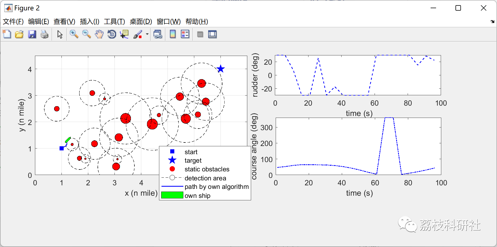
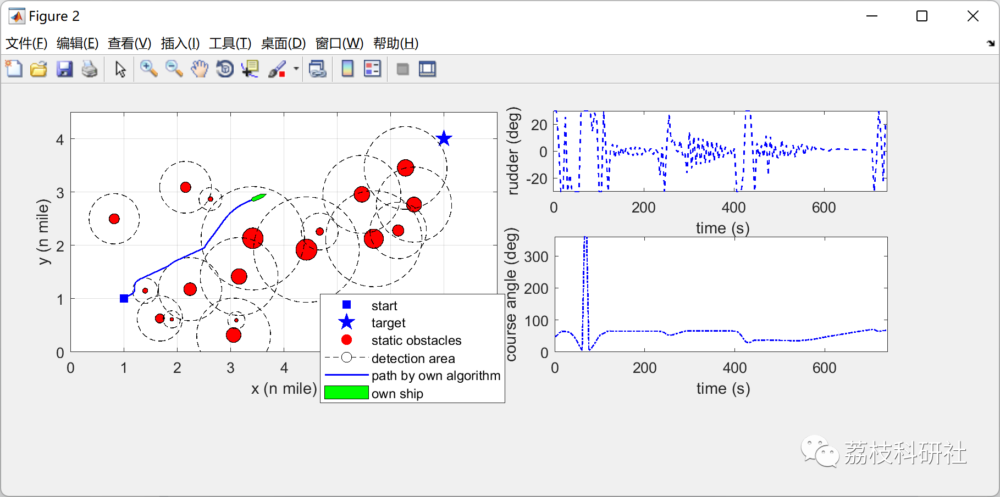
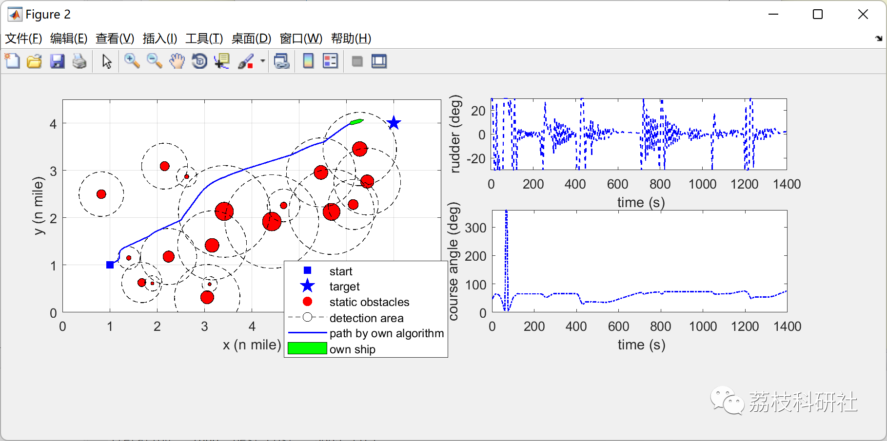
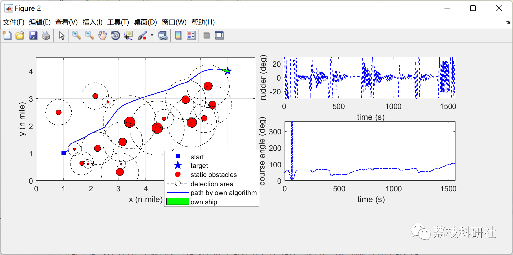

# Ship motion planning method based on model prediction of artificial potential field considering complex encounter scenarios, with COLREG (Matlab code implementation)

Running video:
https://www.bilibili.com/video/BV17g411z7es/  
A ship motion planning method based on model prediction of artificial potential field, considering COLREG in complex encounter scenarios
The input steps can be modified, here the number of steps is 2 as an example:
https://www.bilibili.com/video/BV1Rw411y7xW/?vd_source=c037d7baff5f2e12252827fab197ce79  
💥💥💞💞 Welcome to this blog❤️❤️💥💥
🏆 Bloggers' Advantage: 🌞🌞🌞 The content of the blog strives to be rigorous in thought and clear in logic, for the convenience of readers.
⛳️ Mantra: The journey of a hundred miles is half done in the last ninety.
Litchi Research Society
Code Collection: Power System, Intelligent Algorithms and Applications, Neural Network Prediction, Path Planning, Optimized Scheduling, Workshop Scheduling, Image Processing, Signal Processing...
🎁Column Directory Link:
🌈🌈🌈🌟🌟🌟Electrical Code Intelligent Algorithm and Its Application Path Planning Neural Network Predictive Optimization Scheduling Image Processing Workshop Scheduling Signal Processing Romantic Her My Philosophical Thoughts Math Modeling Complete Code Matters
💥1 Overview
​  
Ship motion planning is a core issue in autonomous surface ships (MASS) navigation. This paper proposes a method of motion planning for complex encounter scenarios, considering collision avoidance rules, based on a model predictive artificial potential field (MPAPF). A new ship domain is established, where an interval potential function is designed to represent the inviolable attributes of the ship domain. During the motion planning process, a Nomoto model with predefined speed is used to generate feasible paths that comply with ship kinematics. To address the local optimal problem of traditional artificial potential field (APF) methods and ensure collision safety in complex encounter scenarios, a motion planning method MPAPF based on model prediction strategy and artificial potential field is proposed. This method transforms the ship motion planning problem into a nonlinear optimization problem with multiple constraints such as maneuverability, navigation rules, and navigable channels. Simulation results from four examples indicate that compared to APF, A-Star, and its variant RRT, the proposed MPAPF algorithm can solve the above problems and generate feasible motion paths to avoid collisions in complex encounter scenarios.
📚2 Running Results
The input prediction step size (we recommend it should be between 1~10; in this program, one step may take you 120 seconds, while ten steps could be 10 times higher than one step.
🎉3 References
[1] He, Zhibo, et al. "A Novel Model Predictive Artificial Potential Field Based Ship Motion Planning Method Considering COLREGs for Complex Encounter Scenarios." ISA Transactions, Elsevier BV, Sept. 2022, doi:10.1016/j.isatra.2022.09.007.
🌈4 MATLAB Code Implementation
Click the "Read More" button at the bottom left of the article.

## Images

<!-- PAYMENT_BLOCK -->

## Get this dataset

- Payment link (Stripe): [Buy now](https://buy.stripe.com/3cs8yP7sY87d0vu9AB)
- Payment QR code: 

<!-- /PAYMENT_BLOCK -->
